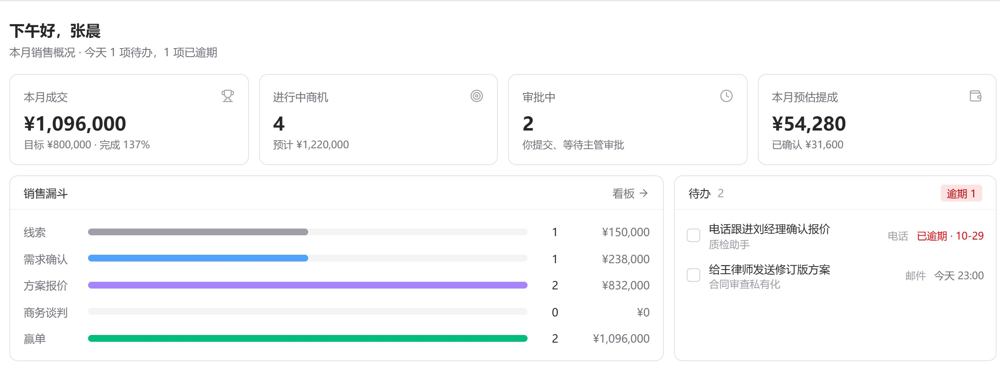
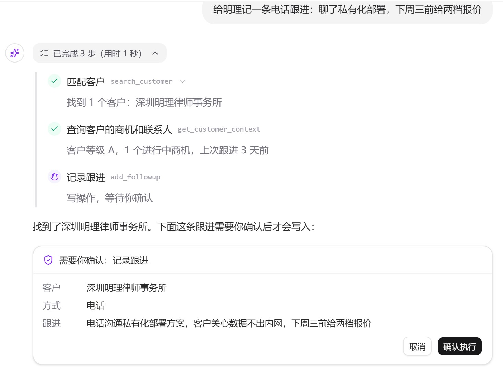
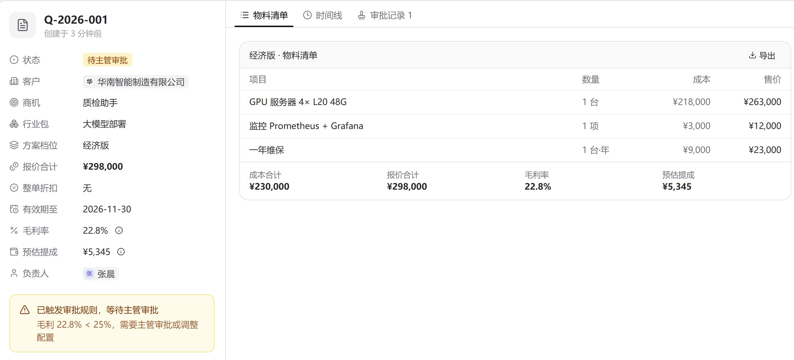
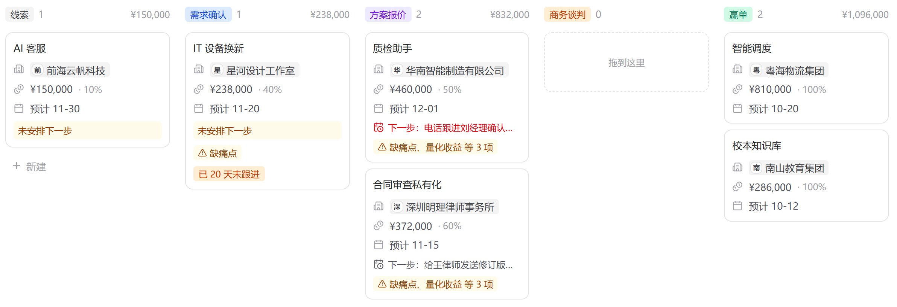

# SalesPilot

**会干活的销售 CRM。** 销售说一句话，AI 去查客户、记跟进、推商机、出报价、提报销；每一笔写入都先给你确认。价格、毛利、提成、报销标准由规则代码计算，不交给大模型。

**在线体验：https://crm.jaxson.bond** —— 打开后在登录页点任一演示账户即可进入，不需要注册（数据为虚构示例，可以随意操作）。



## 为什么做这个

ToB 销售团队用 CRM 常见的三个问题：

- **销售不愿意填。** 跟进、报价、报销全是表单，填得越少，数据越不可信，主管越看不清。
- **跟钱有关的数字靠手算。** 报价毛利够不够、这单提成多少、这顿饭超没超标，各算各的，事后对不上。
- **流程断在半路。** 报价批了没人发，回款逾期没人催，人走了客户没人接。

SalesPilot 的做法：

| 问题 | 做法 |
|---|---|
| 不愿意填 | 用自然语言下指令，AI 通过 function calling 调用真实业务接口完成；会议纪要、聊天记录、名片可以直接粘贴，整理成跟进和联系人 |
| 数字算不准 | 毛利、提成、报销标准全部在 `rules.yaml` 里配置、由代码计算；超出规则自动转主管审批 |
| 流程断档 | 报价 → 审批 → 合同 → 回款 → 开票 → 提成自动串起来；到期、逾期、停滞自动提醒，点通知直达要处理的那一条 |

## 一天里怎么用

**销售**

> 「给明理记一条电话跟进：聊了私有化部署，下周三前给两档报价」

AI 先匹配客户、查当前商机，再给出确认卡；点「确认执行」才写入，并附上记录入口。



> 「华南智能制造要上质检大模型，200 人用，预算 50 万左右」

AI 按行业包估算配置，给出高 / 中 / 低三档方案，毛利不达标会自动重新配；选定一档生成报价单。毛利低于规则线的报价自动提交主管审批，通过后才能发给客户。



客户接受报价后，系统自动生成合同和预估提成，商机标为赢单。之后每登记一笔回款，按比例确认一部分提成；工作台随时能看到「这个月能拿多少」。

**销售主管**

- 审批中心处理超标报价和报销，可以批量处理；
- 看板查看团队商机，拖拽推进阶段（可撤销），赢单 / 输单需要确认；
- 登记回款和开票，按月给每个人定业绩目标；
- 有人离职或调岗，按人一键交接客户和商机。



**系统管理员**

管理成员与团队、配置模型接入、维护行业包（产品目录价格、业务规则、知识库文档）、查看操作日志和 AI 用量。

## 行业包

产品目录、报价算法、业务规则、知识库和话术都按行业打包，放在 `services/core/app/packs/<pack_id>/`。新增一个行业只加一个包，不改主体代码。目前内置：

| 行业包 | 适合 |
|---|---|
| 大模型部署 | 私有化大模型、算力服务器方案 |
| 企业办公 IT | 办公电脑、网络、外设批量采购 |
| 软件外包 | 定制开发报价：拆功能模块、估人天、区分一期 / 二期，可上传客户样例图片判断识别难度 |

团队可以设置默认产品线，AI 对话会跟随对应的行业包检索资料。

> 内置的客户、价格、提成比例、报销标准和知识库文档都是**示例数据**。正式使用前请在「行业包配置」里换成真实资料，详见 [功能说明](docs/功能说明.md#学习问答新人带教)。

## 快速开始

### 环境要求

| 用途 | 需要 |
|---|---|
| 一键启动（推荐） | Docker Desktop / Docker Engine，含 Compose v2；空闲内存 ≥ 4 GB |
| 本地开发（可选） | Python 3.12 + [uv](https://docs.astral.sh/uv/)、Node.js 20 + pnpm 9、Docker（只跑数据库和网关） |
| 大模型（可选） | 混元 / DeepSeek / 通义 / 硅基流动任意一家的 API Key；**不填也能启动**，AI 退回规则模式，其余功能不受影响 |

### 端口

| 服务 | 端口 | 说明 |
|---|---|---|
| web | 3000 | 前端页面，`/api/*` 代理到 core |
| core | 8000 | 业务接口；Swagger 文档 http://127.0.0.1:8000/docs |
| gateway | 8100 | 模型网关（只给 core 调用） |
| db | 5432 | PostgreSQL 16 + pgvector |
| nginx | 8080 | 与线上相同的入口（`docker compose --profile prod up -d` 时启动） |

### 启动

Windows 下请访问 `127.0.0.1`，不要用 `localhost`（可能解析到 IPv6 而卡住）。

```bash
cp .env.example .env                 # 不填模型 Key 也能启动，AI 会退回规则模式
docker compose up -d --build         # db / gateway / core / web
docker compose exec core python -m seed   # 导入演示数据
```

打开 http://127.0.0.1:3000 ，在登录页点演示账户进入（初始密码见 `.env` 的 `DEMO_PASSWORD`，登录后左下角可切换）：

| 角色 | 账号 | 可以试 |
|---|---|---|
| 销售 · 张晨 | `zhangchen` | AI 出方案、对话记跟进和报销、看板拖拽 |
| 销售 · 王磊 | `wanglei` | 与张晨同组，验证销售之间数据隔离 |
| 销售主管 · 李薇 | `liwei` | 审批、团队商机、登记回款、按人交接 |
| 系统管理员 · 周敏 | `zhoumin` | 成员与团队、模型接入、行业包配置 |
| 销售主管 · 陈静 | `chenjing` | 华东销售组（软件外包），只看得到本团队的数据 |
| 销售 · 刘洋 / 赵婷 | `liuyang` / `zhaoting` | 华东销售组的销售，AI 出软件外包方案 |

分享给别人试用前，恢复干净的演示数据并把演示账号密码统一为 `DEMO_PASSWORD`：`python -m seed --reset --reset-passwords`。
> `--reset` 会清空**所有**业务数据（包括试用者录入的），执行前列出要删的数量并要求输入 RESET；非交互运行需加 `--yes`。`--reset-passwords` 会让已登录的演示账号全部下线。部署流水线不会执行 seed。

接入大模型：在 `.env` 填至少一家厂商的 Key，或登录管理员后在「系统设置 → 模型接入」里配置。支持混元、DeepSeek、通义，以及任意 OpenAI 兼容接口。

正式部署：设 `DEMO_LOGIN=false` 关闭演示账户，修改所有密钥和默认密码，只对外暴露 nginx。步骤见 [上线部署指南](docs/上线部署指南.md)。

### 联调

启动后按顺序确认各层都通了：

```bash
docker compose ps                                   # 5 个服务都是 running / healthy
curl -s http://127.0.0.1:8000/api/health            # core：{"code":0,...,"data":{"status":"ok","db":true,...}}
curl -s http://127.0.0.1:8100/health                # gateway
curl -s http://127.0.0.1:3000/api/health            # web → core 代理
```

然后用演示账户登录，带 token 调业务接口（完整示例、请求 / 响应样例和错误码见 [接口说明](docs/api/接口说明.md#4-用-curl-联调)）：

```bash
TOKEN=$(curl -s -X POST http://127.0.0.1:8000/api/auth/mock-login -H 'Content-Type: application/json' \
  -H 'X-Requested-With: fetch' -d '{"role":"sales"}' | jq -r .data.token)
curl -s "http://127.0.0.1:8000/api/customers?page_size=2" -H "Authorization: Bearer $TOKEN"
```

自动化联调：`tests/e2e/` 用 HTTP 把「客户 → 商机 → 报价 → 审批 → 合同 → 回款 → 提成」和报销、权限隔离整条跑一遍；`apps/web/e2e/` 用浏览器跑同样的流程。命令见下方「开发」，结果见 [测试与联调报告](docs/测试与联调报告.md)。

## 架构

```
浏览器 ── web（Next.js）── /api/* ──▶ core（FastAPI + LangGraph）──▶ gateway（LiteLLM）──▶ 混元 / DeepSeek / 通义 / …
                                         │
                                         └──▶ PostgreSQL 16 + pgvector（业务数据 · 知识库向量 · 会话状态）
```

| 服务 | 技术 | 职责 |
|---|---|---|
| web | Next.js 15 · React 19 · Tailwind · shadcn/ui · TanStack Query | 界面；`/api/*` 代理到 core |
| core | Python 3.12 · FastAPI · SQLAlchemy 2 · LangGraph | 业务规则与权限、Agent、行业包、RAG、定时任务 |
| gateway | FastAPI · LiteLLM | 统一的 OpenAI 格式模型入口：注册表、主备切换、各家兼容差异 |
| db | PostgreSQL 16 + pgvector | 业务数据、知识库向量、Agent 会话检查点 |

几条设计约束：

- **AI 只调工具，不碰数据库。** Agent 工具是 service 的薄包装，和网页走同一套权限与规则；所有写工具必须经过用户确认才执行。
- **数字只由规则代码算。** 阈值在 `rules.yaml`，大模型只负责理解意图和组织语言。
- **权限在服务端。** 销售看自己、主管看本团队、管理员看全部，在 service 层统一过滤；界面上无权的按钮直接隐藏。
- **模型可替换。** core 只认网关；换厂商、加模型只改网关配置或在网页上配置。

更多：[架构设计](docs/架构设计.md) · [架构图](docs/架构图.html) · [接口说明（示例 + 错误码）](docs/api/接口说明.md) · [OpenAPI](docs/api/openapi.yaml)（运行时 http://127.0.0.1:8000/docs） · [逐版接口契约](docs/api/业务模块接口契约.md) · [功能说明](docs/功能说明.md)

## 开发

```bash
docker compose up -d db gateway                       # 数据库和网关用容器
cd services/core && uv sync && uv run alembic upgrade head && uv run python -m seed
cd services/core && uv run uvicorn app.main:app --reload --port 8000
cd apps/web && pnpm install && pnpm dev               # http://127.0.0.1:3000
```

| 测试 | 命令 |
|---|---|
| core 单元 + 接口 | `cd services/core && uv run pytest`（独立测试库 `crm_test`，模型用剧本代替，不需要 Key） |
| gateway | `cd services/gateway && uv run pytest` |
| 前端 | `cd apps/web && pnpm lint && pnpm typecheck && pnpm test` |
| 接口端到端 | `uv run --python 3.12 --with httpx --with pytest pytest tests/e2e -q` |
| 浏览器端到端 | `cd apps/web && PW_CHANNEL=msedge pnpm test:e2e` |

端到端测试会真实写入数据：跑之前先注释掉 `.env` 的 `WECOM_WEBHOOK_URL`（否则测试会拒绝运行），跑完用 `pnpm e2e:reset` 恢复演示数据。

改了接口后运行 `cd services/core && uv run python scripts/export_openapi.py`，再 `cd apps/web && pnpm gen:api`。启用提交前检查：`git config core.hooksPath infra/git-hooks`，改到 Agent / 模型 / 行业包代码时会用真实模型跑 AI 评估并与基线对比。

编码规范见 [AGENTS.md](AGENTS.md) 和 [开发规范](docs/开发规范.md)；项目用 Claude Code 辅助开发，每个阶段的任务、AI 出错和人工修正记录在 [docs/ai-log](docs/ai-log/README.md)。

## 目录

```
apps/web            前端（页面、组件、hooks、纯函数 lib、Playwright e2e）
services/core       业务 + Agent + 行业包 + RAG
  app/crm             routers → services → models（权限在 service 层）
  app/agent           LangGraph 状态图与工具
  app/packs           行业包
  app/rag             文档加载、切块、入库、检索、评测
  app/rules           rules.yaml（标准 / 阈值）+ 计算器
services/gateway    模型网关
infra/              nginx、git hooks
tests/e2e           接口端到端测试
docs/               架构、接口契约、部署、功能说明
```

## 提交材料对照

| 要求 | 位置 |
|---|---|
| 在线链接 / 本地启动说明 | 在线：https://crm.jaxson.bond ；本地：上方「快速开始」（环境要求、端口、启动、联调） |
| 源代码仓库 | https://github.com/Jaxson-zip/SalesPilot |
| 环境配置（不含真实 Key） | [.env.example](.env.example)：每一项都有说明，Key 全部留空；真实 `.env` 已在 `.gitignore` 中 |
| 接口契约 | [接口说明](docs/api/接口说明.md)（路径、请求 / 响应示例、错误码）· [OpenAPI](docs/api/openapi.yaml)（130 个接口，有测试保证与代码一致）· Swagger：http://127.0.0.1:8000/docs |
| 单元 / 接口 / 联调测试 | core `services/core/tests`（unit + api）· gateway `services/gateway/tests`（录制样本，不连外网）· 前端 `apps/web/lib/__tests__` · 接口端到端 `tests/e2e` · 浏览器端到端 `apps/web/e2e`；汇总见 [测试与联调报告](docs/测试与联调报告.md) |
| Dockerfile / 容器启动 | `services/core/Dockerfile`、`services/gateway/Dockerfile`、`apps/web/Dockerfile`、[docker-compose.yml](docker-compose.yml)（开发）、[docker-compose.prod.yml](docker-compose.prod.yml)（线上）、`infra/nginx`；CI/CD 见 `.github/workflows` |
| AI Coding 使用记录 | [docs/ai-log](docs/ai-log/README.md)：每个任务的任务卡、AI 写错的地方、怎么发现、怎么修；AI 协作规范 [AGENTS.md](AGENTS.md)；提交信息用 `[AI]` / `[AI-fix]` 区分 |
| 技术规范文档 | [开发规范](docs/开发规范.md) · [架构设计](docs/架构设计.md)（模块职责、关键技术决策）· [架构图](docs/架构图.html) · [模型兼容矩阵](docs/模型兼容矩阵.md) · [知识库构建说明](docs/知识库构建说明.md) · [上线部署指南](docs/上线部署指南.md) |
